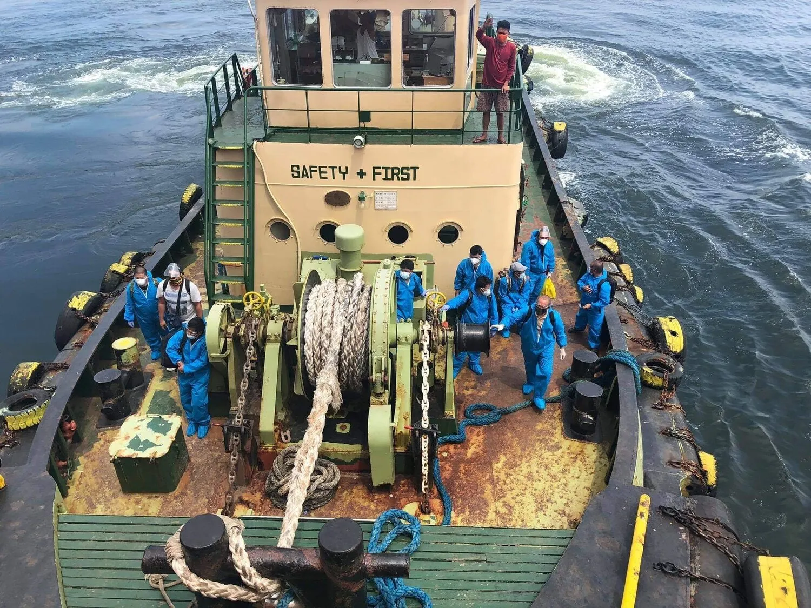

25th of June of each year is the "Day of the Seafarer", recognizing the invaluable contribution seafarers make to international trade and the world economy, often at great personal cost to themselves and their families.

Ships transport around 80 percent of the world’s goods trade. Seafarers are not only responsible for the operations of ships but are also responsible for the safe and smooth delivery of the cargo.

The day not only acknowledges the invaluable work of seafarers, but also aims to bring global attention to the issues affecting their work and lives. It calls on governments to develop policies that lead to fair treatment of seafarers at ports and asks private ship companies and owners to provide their employees proper facilities and comforts while they are at sea.

## New challenges during the pandemic

In the wake of the pandemic, seafarers all around the world found themselves on the front line of the global response and subject to difficult working conditions surrounding uncertainties and difficulties around port access, re-supply, crew changeovers and repatriation. Our crew onboard our  vessels too faced difficulties in the beginning of the pandemic and [we urged governments to act](https://www.combinationcarriers.com/insights-and-news/2020/9/9/extensive-quarantine-measure-is-the-only-way-to-continue-crew-changes-during-the-pandemic).

We are happy to see that collective action made a difference as the 2020 Day of the Seafarer campaign encouraged governments to support seafarers amid the pandemic, and see that we were able to sign off an increasing number of crew in 2021, when compared to 2020, although still challenging.

The 2021 Day of the Seafarer campaign will continue to encourage governments to support seafarers amid the pandemic but will expand its message, calling for a fair future for seafarers. The theme for 2021 seeks to increase the visibility of seafarers by drawing attention to the invaluable role they play now and will continue to play in the future.

The campaign will discuss issues that will still be relevant to seafarers after the pandemic, such as fair treatment of seafarers, fair working conditions (in line with ILO's Maritime Labour Convention), fair training, fair safety, etc.

Torvald Klaveness is proud to support this year’s Day of the Seafarer campaign. Together with the world fleet, we honk our horns at 12:00 local time on all ships to support our seafarers.
