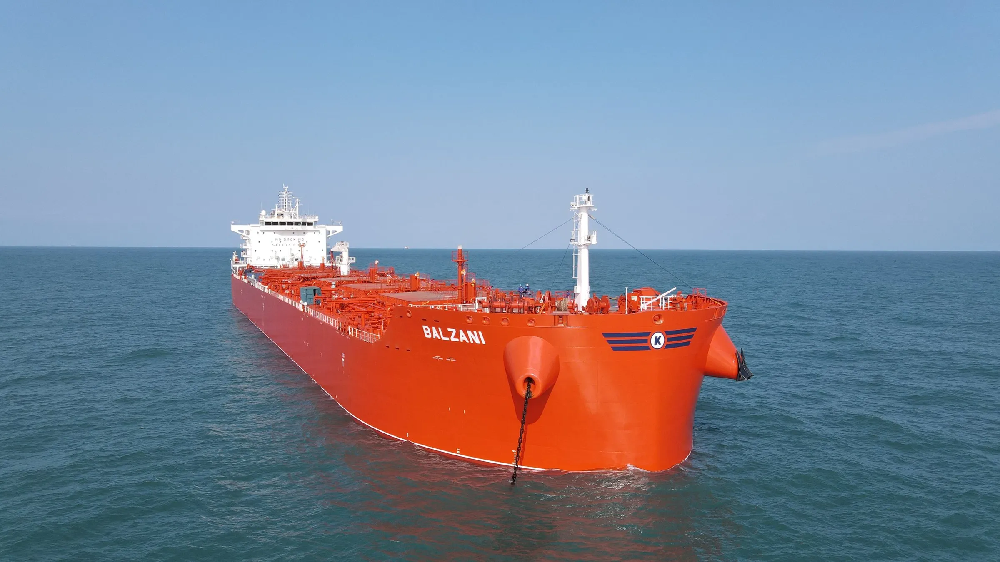

Oslo, 8 December 2021: Yesterday, the CDP scores for the 2021 round of disclosures were released and in its first year of reporting Klaveness Combination Carriers achieved a B score for climate change, identified as taking coordinated action on climate issues. Read our CDP disclosure [here](https://www.cdp.net/en/responses?utf8=%E2%9C%93&queries%5Bname%5D=klaveness).

CDP is a global non-profit that runs the world’s leading environmental disclosure platform. Over 13,000 companies with over 64% of global market capitalization disclosed environmental data through CDP in 2021. CDP scores companies based on a transparent methodology ([link](https://guidance.cdp.net/en/guidance?cid=18&ctype=theme&idtype=ThemeID&incchild=1&microsite=0&otype=ScoringMethodology&tags=TAG-605%2CTAG-646)) based on the comprehensiveness of disclosure, awareness and management of environmental risks and best practices associated with environmental leadership, such as setting ambitious and meaningful targets.

“The B score for climate change from CDP recognizes our efforts to improve our sustainability performance. Based on a clear strategy and ambitious targets, we will continue to work on initiatives to improve our performance both through testing and implementing new technology and fuels, cooperate closely with our customers and improve trading and operation of our existing fleet. On this journey we will be open on the challenges and be transparent on how we perform”, says Liv H. Dyrnes, CFO of Klaveness Combination Carriers ASA.

## For further queries, please contact:

Liv Dyrnes, CFO

Telephone [+47 976 60 561](tel:+4797660561)

## About Klaveness Combination Carriers ASA:

KCC is the world leader in combination carriers, owning and operating eight CABU and eight CLEANBU vessels. KCC’s combination carriers are built for transportation of both wet and dry bulk cargoes, being operated in trades where the vessels efficiently combine dry and wet cargoes with minimum ballast. Through their high utilization and efficiency, the vessels emit up to 40% less CO2 per transported ton compared to standard tanker and dry bulk vessels in current and targeted combination trading patterns.
