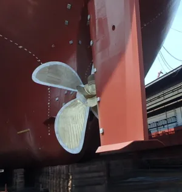

Klaveness Combination Carriers “KCC” and Wartsila have signed a contract securing Wartsila EnergoProFin for CABU vessels MV Bakkedal, MV Bangor and MV Bantry. The device replaces the propeller boss of each vessel and is equipped with tailor-made fins to cancel any vortex from occurring from the boss cap, reducing drag from the vessel.

Aboard KCC’s vessels, the device is expected to give a fuel savings of approximately 2 to 3% and are compatible with the Becker Mewis Duct  planned for installation also on these vessels. Both devices are scheduled to be installed during these vessels’ planned dry dockings over 2022.

KCC has previously  installed the Wartsila EnergoProFin on the sister vessels MV Barcarena and MV Banastar, and feedback from these installations has been positive. With this order all five CABU I vessels built 2001-2007 are equipped with the technology.

---

### Fact box: Wartsila EnergoProFin

Consists of a propeller boss fitted with short blades inclined to convert hub vortex energy into additional torque and thrust transmitted back to the shaft.

The elimination of propeller hub vortex results in fuel savings, reduced stern vibrations and lower propeller noise. It also solves a number of rudder erosion problems.

*Source: Wartsila.com*

---

## About Klaveness Combination Carriers ASA:

KCC is the world leader in combination carriers, owning and operating eight CABU and eight CLEANBU vessels. KCC’s combination carriers are built for transportation of both wet and dry bulk cargoes, being operated in trades where the vessels efficiently combine dry and wet cargoes with minimum ballast. Through their high utilization and efficiency, the vessels emit up to 40% less CO2 per transported ton compared to standard tanker and dry bulk vessels in current and targeted combination trading patterns.
