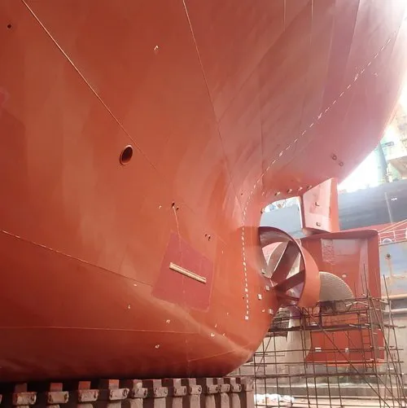

MV Banastar is completing docking and fourth special survey this weekend with several energy efficiency measures implemented to reduce carbon emissions.

Having celebrated her 20th birthday this October, MV Banastar is currently being retrofitted with a Becker Mewis Duct (pictured) and several other energy efficiency measures during her docking in China

Banastar will be the first of KCC’s vessels to benefit from this solution, with the ambition to roll out the upgrade to the entire KCC fleet.

KCC’s investments in greener solutions never stop!

## About Klaveness Combination Carriers ASA:

KCC is the world leader in combination carriers, owning and operating nine CABU and eight CLEANBU vessels. KCC’s combination carriers are built for transportation of both wet and dry bulk cargoes, being operated in trades where the vessels efficiently combine dry and wet cargoes with minimum ballast. Through their high utilization and efficiency, the vessels emit up to 40% less CO2 per transported ton compared to standard tanker and dry bulk vessels in current and targeted combination trading patterns.
