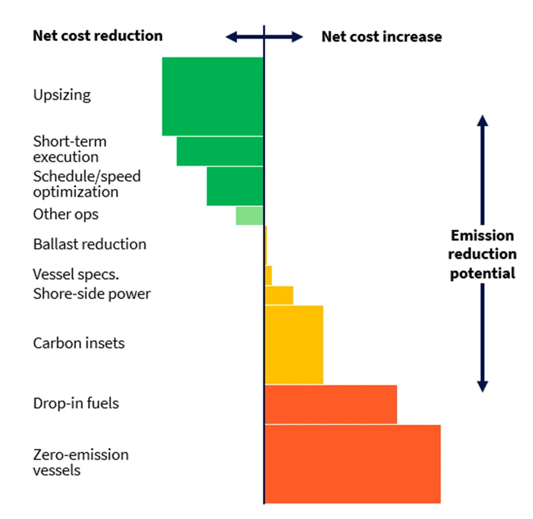

*A ZeroLab opinion piece first published by Gatfworld in Dec ‘22*

Climate change and its deadly consequences from drought, rising sea levels, and the increased frequency of extreme weather events and changing precipitation patterns are well known to the grain industry. Over the next decades, supply chains must (and will) shift in response to the climate crisis.

Adapting to climate change requires insight into climate risk along the entire value chain, from farm to fork. At Torvald Klaveness, we are dedicating ourselves to the realization of decarbonized, cost-effective, and resilient seaborne supply chains for our customers. Emissions from the seaborne supply chain typically belong to the ‘Scope 3’ emissions category: known as indirect emissions in the value chain, including both upstream and downstream activities. It is an emissions category taking on increasing relevance today, as companies face up the fact that to get to net zero - collaborative, commercially grounded partnerships along the supply chain are needed. In the following we will address how this plays out in the maritime domain.

## In dry bulk shipping, grain is the second biggest emitter after coal

In dry bulk, grains constitute around 12% of the annual volume, the equivalent of as much as 21% of total carbon emissions from dry bulk shipping. With 50 million tons of CO2 emitted each year to transport grains around the world, second only to coal transportation, the figure underpins just how much potential there is for the grains industry to improve. In fact, it is equivalent to the carbon emissions avoided by running almost 50 000 wind turbines for a year, or the annual electricity use of more than 35 million homes\[1\].

If all those emissions were subject to the carbon price that will be applied to shipping emissions in and out of the EU as of 2024, it will cost grain exporters **more than 3.5 billion dollars each year**. In this decade, regional carbon pricing will become a reality, firstly in Europe, and towards the end of the decade we are likely to see a global carbon price on shipping emissions.

The financial climate risk for supply chains for grains is thus significant. Yet somehow, it remains largely de-prioritized despite the economic case for managing it better.

## A holy grail of untapped potential

Research from BCG and the World Economic Forum found that “... the costs of deep decarbonization across supply chains are surprisingly low and result in an increase of only 1-4% on end-consumer prices.” We have applied our own research to see how levers that are available today compare on emission reduction potential and abatement costs and were stunned to discover a holy grail of inefficiencies that, addressed systematically, can reduce both cost and emissions – the latter with up to 30 percent. This saves transportation costs today, and acts against an insurance for increased freight rates for when low- and zero-carbon fuels are introduced.

Managing the unknown

There are many unknowns still about the future fuel of choice for deep sea shipping, but we are certain about two things: it will be more costly, especially in the phase-in period up to 2040, and we will have to factor in carbon costs. For shipping in and out of the EU, change is imminent with the inclusion of shipping in the EU Emission Trading Scheme (EU ETS) from 2024. The allowance price is currently at an all-time high at around $80/tCO2.

## Future-proof your shipping strategy now

In Klaveness, we advise our clients along three main lines when they begin the work to decarbonize their seaborne supply chain:

Step 1: Gain visibility into your supply chain through emission monitoring (and reporting)

All good strategies start with good data. Get the emission inventory in order and establish a baseline. We advise our customers to follow the emerging industry standard developed by the Sea Cargo Charter (SCC), a framework to assess and disclose the climate alignment of ship chartering activities. SCC members from the grain industry include Bunge, ADM, Cargill and Amaggi.

Viterra is another company that is tackling its Scope 3 emissions head on. Upon announcing its net-zero goal for 2050, the company committed to specific targets for its Scope 1 and Scope 2 emissions and announced that it would start measuring its Scope 3 emissions as part of its goal to decarbonize its supply chains. \[IK1\]

Step 2: Use the data to gather intelligence about where you can improve efficiency.

Do your vessels sail too fast, wait too long in ports, or ballast long distances? Those are all areas that can be improved in a cost-efficient manner. To use the Australian market as an example: the vessels from Klaveness Combination Carriers cut ballast by combining inbound shipments of petroleum products with outbound shipments of dry bulk commodities such grains. Through superior trading efficiency and minimizing time with no cargo onboard, KCC’s vessels cut carbon emissions per ton transported by 30-40% when compared to standard bulker and tanker vessels operating similar trade routes.

Step 3: Use the visibility and the intelligence gathered through emission monitoring to develop truly collaborative partnerships with shipowners and operators.

Dare to challenge existing solutions. As we turn every stone to make decarbonization of shipping a reality, new business models must be tried and tested. That can for example include a carbon adjustment factor in contracts, whereby the freight paid depends on the emission performance relative to a baseline.

It is said that the future cannot be predicted. We beg to differ: Managing climate risk, physical and financial, will become increasingly important in supply chain management, and carbon pricing will become the norm.

Now is a good time to ask yourself, is your shipping strategy future-proof?

\[1\] [www.epa.gov](http://www.epa.gov/)
