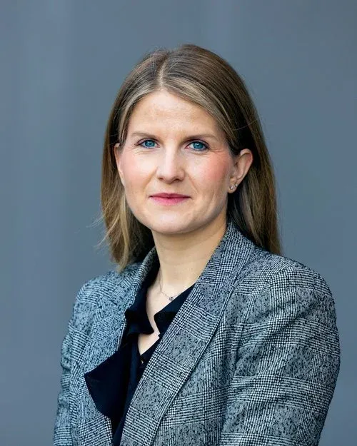

A ZeroLab opinion piece first published in [Aluminum International Today Nov/Dec ‘21 edition](https://aluminiumtoday.com/issues/latest)

Bill Gates has taught us to ask five questions about any climate solution to assess if it is worth the investment. By applying a few tweaks to Gates’ framework, the test can be applied to almost any given supply chain to ask the question - is changing your strategy in favor of low-carbon shipping worth the effort?

## Question #1: How much of the 51 billion tonnes are we talking about?

Every year, the world adds approximately 51 billion metric tonnes of CO2 and other greenhouse gases to the atmosphere, of which shipping contributes with around 1 billion, or 2-3 % – the same as the whole aluminium industry.

After 2008, the increase in seaborne trade was decoupled from growth in emissions, primarily due to slow steaming and new engines. But now, emissions are once again on the rise, and that qualifies for action according to the Gates’ framework, even though the share of total global emissions remains relatively low.

Any supply chain strategy that includes sustainability must now look at how it can support a shift to decarbonized transport. Investors increasingly demand concrete emission reduction initiatives along a company’s supply chain, so it also makes financial sense.

## Question #2: What is your plan for aluminium?

> *Fact box: Scope 3 emissions are the upstream and downstream value chain emissions and include emissions from transport of supplies as well as transport of products. Shipping emissions are thus part of the Scope 3 emissions for aluminium producers.*

Taking an industry perspective, an improved carbon footprint is the common objective. To maintain a competitive edge in a world that must move to net-zero, companies that want to be at the forefront must have a thorough supply chain strategy to support the development of low-carbon aluminium. Shipping is a small share of aluminium companies’ total Scope 3 emissions but is an area where it is possible to identify and realise immediate emission reduction initiatives. For every tonne of aluminium delivered to the end-user, 8-10 tonnes of raw materials may have been transported by sea. Assuming 20-50 kg CO2 equivalents per tonne cargo (depending on vessel size and distance), the share of shipping emissions is 0.2-0.7 tCO2 e/ tonne aluminium produced. For companies competing for market shares in the low-carbon aluminium market, that is a number that counts.

## Question #3: How much energy are we talking about?

A Panamax-sized vessel on a transatlantic voyage typically carries fuel equivalent to 11 GWh. The annual fuel consumption of such as vessel is around 88 GWh, it takes the annual production of three very large wind turbines to meet that demand. The overall shipping industry consumes around 300 million tonnes of fuel oil per year, which is equivalent to Germany’s annual energy consumption. In other words, these are meaningful numbers to address, and the aluminium industry can be a major influencer: Around 100 million tonnes of bauxite are transported by sea each year – as just one of several commodities used by the aluminium industry.

## Question #4: How can you make better shipping choices?

The aluminium industry has significant procurement power to push shipping to decarbonize. Zero-emission fuels are not yet available at scale for deep-sea shipping, but there are other levers to pull for industry players that want to reduce emissions, starting today:

- Get the emission inventory in order and establish a baseline. One method is to follow the emerging industry standard by using the charter party clause and template developed by the Sea Cargo Charter, a framework to assess and disclose the climate alignment of ship chartering activities.
- Bigger is better: One of the two main factors driving fuel consumption is size. Larger vessels are a lot more efficient than smaller vessels, so a chartering ‘rule of thumb’ should be to always consider if a bigger vessel could be an option.
- Incentivize smart operations. Ensure that the operator is incentivized to deliver carbon-efficient voyages through smart contract clauses that reward CO2 -savings.
- Consider fuel switching. Sustainable biofuel may be available, or carbon insets could be used to ensure that the emissions from a given voyage is compensated through a fuel switch on another voyage.

## Question #5: How much is this going to cost?

Research from BCG and the World Economic Forum found that “... the costs of deep decarbonization across supply chains are surprisingly low and result in an increase of only 1-4% on end-consumer prices.” The measures outlined here concern immediate, short-term decarbonization and will, in most cases, not have a significant impact on shipping costs. The exception is fuel switch, either by using biofuel directly in operation or by purchasing Scope 3 emission rights derived from biofuel used on other ships, so-called carbon insets. These insets are available from around $100/ tCO2 e. Shipping in and out of the EU (and intra-EU) is scheduled to be included in the EU Emission Trading Scheme (EU ETS) from 2023. Currently the EU ETS allowance price is at its all-time high, with a carbon cost of around $70/tCO2e this means that a carbon price must be factored in. Many expect this price to increase further over the coming years. To future-proof chartering activities, companies should apply an internal carbon price to their chartering activities. Many of the operational initiatives outlined in this article already make financial sense. By using an internal carbon price that reflects the EU ETS carbon price, a whole new range of decarbonization measures will become financially viable. Reducing the carbon footprint from shipping will reflect positively on the end-product. As end-users increasingly engage with their Scope 3 emissions, being able to demonstrate commitment to decarbonize wherever possible in the supply chain increases a company’s competitive advantage.

## Looking ahead

An analysis of mentions of Scope 3 emissions in the media in 2017 revealed a mere 1 000 mentions. In 2020 that number grew to 15 000 mentions, and this is on track to double for 2021. As industrial companies face increasing pressure to engage with their supply chain on decarbonization initiatives, expect the focus on climate-aligned chartering to increase. There is a noticeable shift in industrial companies now increasingly requiring operators to report shipping emissions. The next step is to act on those numbers. In the short term, the demand for energy-efficient vessels will be tight as will demand for biofuel. This will likely come from European-bound charterers first, but demand for supply chain decarbonization is not only driven by regulators; investors also see the value of reducing the carbon risk in supply chains. Ultimately, what the focus on Scope 3 emissions reveals is that sustainability is no longer ‘only’ about looking at one’s own operations. It is to develop a supply chain strategy that ensures emissions are reduced wherever feasible – both from an operational, technical, and financial point of view. The chartering department is a good place to start. Done right, the aluminium industry could change the nature of shipping.

## About ZeroLab

Established in 2021, ZeroLab is the youngest explorer amongst the Klaveness companies and is dedicated to the decarbonization of seaborne supply chains. ZeroLab is currently developing several initiatives to make low-and zero emission options available to our customers. We partner with ambitious cargo owners who want to lead the way in creating a market for low-carbon deep sea shipping and help our customers identify and reduce carbon risk in their seaborne supply chains.
