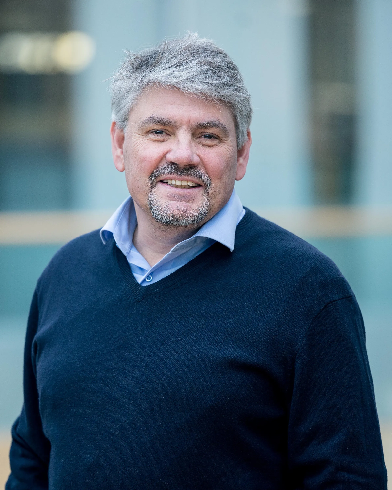
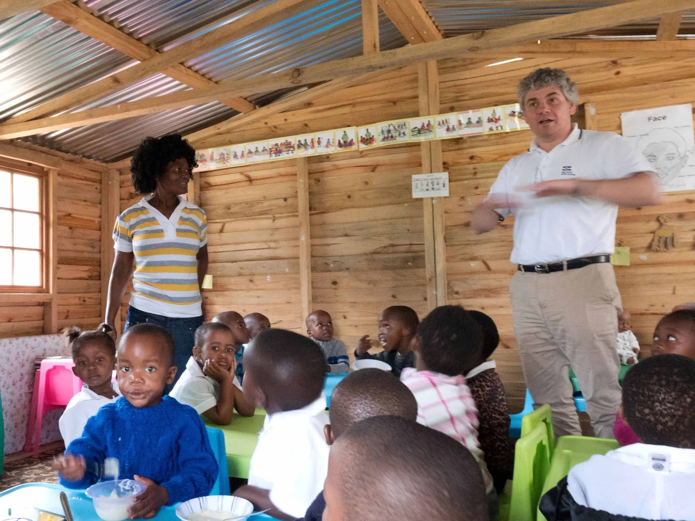
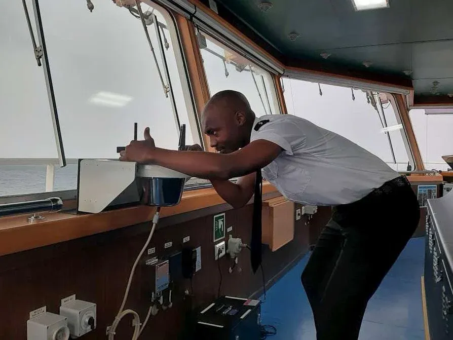
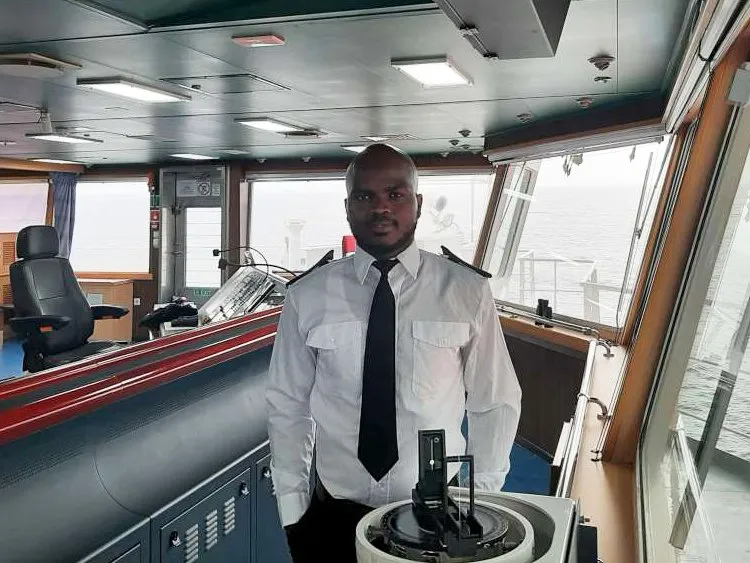

The Philippines has long been the world’s largest supplier of seafarers, serving up no shortage of talent to the pool of over 1.6 million sailors that make up the backbone of global logistics. At Klaveness, our fleet is largely made up of its own share of dedicated Filipinos, Romanians, a minority share of other Europeans, and now, thanks to the vision of VP Maritime Personnel Torbjørn Eide, a 5% (and growing) share of South Africans.

The South African project has primarily been pioneered by Eide for the past decade, who comments, “complementing the nationalities aboard our vessels is an important and valuable experience for our sailors, and we see South Africa as a well of untapped potential from a skills and people development perspective.”

## Enhancing social welfare in less fortunate regions

All crewing is handled by Klaveness Ship Management (KSM), which prides itself on a 97% retention rate. Central to KSM’s leading retention rate is the Manpower Development Program (MDP), where Eide is a leading figure. Originally conceived in The Philippines, the MDP has been successfully recruiting and training all future Ratings for close to 20 years from less fortunate areas, helping to enhance social welfare in those regions. Successful Ratings then have opportunities to progress their careers onboard, ultimately leading to Officer and upper management promotions for crew mates of outstanding merit.

Now successfully established in South Africa, the MDP recruits future Ratings from the age of 18 (maritime law’s minimum age), then sends the students through a training program, prior to embarking as deck and engine personnel. Commenting further on the South Africa focus, Eide explains, “once we learned investing in South Africa could bring new opportunities, we were quick to discover there lies our next generation of sea talent. Over the years, we explored regions, built local networks, and gradually sent future Ratings through the MDP, before settling on the Ugu district as our center of gravity.”

Located on the Eastern shores of South Africa by the city of Durban, the Ugu district currently has over 700 000 residents, but very low rates of education and employment. Eide adds that an important step to succeeding was connecting with the local communities and establishing a partnership with The Impande Foundation.

Through its partnership with Klaveness and others, Impande has provided the region with vital support for Early Childhood Development. Managing Director for Impande Norway, Andrea Lothe, advises that more than one million meals are provided annually to children in kindergartens, 179 classrooms have been built for unregistered kindergartens, and 18 000 children have received books and toys. Lothe adds these actions have greatly helped the 40 000 children in kindergartens, in addition high-school students and those studying maritime, law and other professions.

“With strong partners that know where their social investment gets the best return, we can make a tremendous impact in these communities. Working with local grassroot organizations and governments enables us to make real change, not just for individual lives but for the community at large,” praises Lothe.

## Climbing to greater heights

Wonderboy Nzimande and Martin Mluleki Gambushe are two of the South African nationals that hail from the Ugu district and currently sail with Klaveness, both serve as Deck Cadets aboard MV Baru. The sailors started their careers with Klaveness as Rating Trainees in the MDP, before applying on their own initiative to Durban University of Maritime studies.

Nzimande started as an Engine Hand in 2015 and points out the warm crew is what he enjoys most about his job, “if the crew onboard always gives a welcoming hand, it makes the ship a home away from home.” Gambushe, who began as Deck Hand in 2017, adds that working in a safe and healthy environment is essential for anybody, and “with good humanity regardless of your nationality, you grow as a human being, for which I am grateful. I really appreciate the opportunity to be one of the few South Africans onboard knowing that teamwork is our culture.”

When asked about their motivation for enrolling in Durban University, Nzimande cites passion and the will to climb to greater heights as his drive, adding, “sometimes enthusiasm is born having the best teachers alongside you.” Gambushe comments, “I believe I can use my leadership skills in order to motivate and inspire fellow seafarers to be better human beings, which I believe is what we are all striving to become.”

With both now progressing through the MDP after starting their tour as Deck Cadets this year, Nzimande explains his long-term goal is to become Master, adding that his skills, “combined with the good training received from wonderful and experienced senior officers, I believe I have that potential.” Gambushe is striving for similar, with an aim to become of the KSM’s Senior Officers and pass his knowledge onto future generations.

## Looking ahead

“Wonderboy and Martin are just two of the fine examples of the hard-working and passionate sailors we have been fortunate to welcome from the Ugu district, and we see similar promise emerging elsewhere in the fleet,” commends Eide. He adds that KSM’s development ladder climbed by the Cadets is fundamental to the MDP, giving any sailor equal opportunity to progress through the ranks.

Moving forward, Eide and his team plan to further develop the South Africa region for future recruits, welcoming more young sailors from the Ugu district into the MDP as Ratings, and directly from Durban University as Cadets. And, as demonstrated by the cases of Nzimande and Gambushe, will continue to support the Ratings in the MPD that possess the potential to progress further into Durban University and continue as Cadets.

Lothe concludes, “for all we know the Ugu district may hold the world’s next Nobel Peace Prize winner or captain of industry. We are proud to be supporting its youth in getting an education and securing work so they can discover such opportunities, while helping them to support their families and community. The inspiring journey of Martin and Wonderboy with Klaveness illustrate this well and being a part of that journey is a blessing. It’s a win-win we should all aim for!”

---

Learn more about The Impande Foundation: [here](https://www.impande.com/en/)

Learn more about KSM: here
