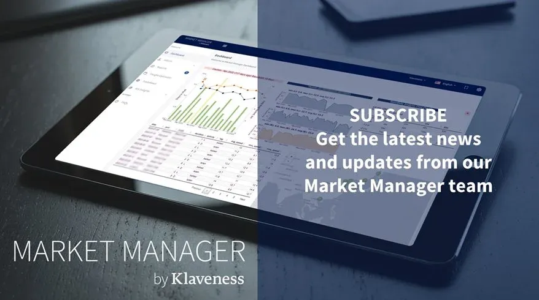

Every so often, the Market Manager team shares insights through their newsletter. Here’s a sneak peek at what they may typically share in case you would like to be the first to know. Subscribe at the bottom to get these straight to your inbox.

In our newsletters, we take some time to share more about the latest Market Manager developments, how we create value within Klaveness, and how the industry can benefit from these products.

Market Manager is the digital platform that our commercial chartering team uses to support their decision-making processes. It considers specific decision-making junctures that are addressed in our chartering strategy and consists of value-driven solutions that support these decisions, and positively affect results.

## Newsletter #1: Pre-Vetting by Market Manager

In the first installment of our Newsletter series, we shared about our breakthrough product, Pre-vetting, which has preserved the value of our earnings tremendously since the Dry Bulk chartering team has made it an essential part of the TC-In process. An actual example of Pre-Vetting in action was also included.

A big reason for its success lies with the fact that it was developed and refined in conjunction with Chartering personnel. The process from identifying the pain point to its current state was also documented in the Newsletter.

## Newsletter #2: Market Manager - what it is, how it can be used and how it creates value

After sharing about Pre-Vetting, our first product available for the Dry Bulk industry, several industry participants reached out to us to learn more about the Pre-Vetting and Market Manager. This led us to our latest Newsletter, sharing specifics around Market Manager.

In this Newsletter, we offered exclusive access to the workings of Market Manager including the process that Market Manager takes to developing the platform and the products that reside within.

Uniquely positioned within a company with a dry bulk operating arm, Market Manager has firsthand experience of the value chain in dry bulk shipping. We explain how we use this advantage to benefit our customers by coming up with products that deliver tangible impact to earnings. Most importantly, we share about how the products have been designed with the chartering personnel in mind to tackle specific problems in the best way possible.

At the end of the day, the team strongly believes in collaboration and that we are all better off working together with partners. In this newsletter, we explain our strategy going forward on how we will be improving the nature of shipping together with willing partners!

Looking to learn how we can create value from your existing shipping activities or just interested in staying up to date with our most recent work? Subscribe to our newsletter below.

## Subscribe to the Market Manager newsletter

**Michael Jørgensen**
Head of Dry Bulk
Torvald Klaveness
