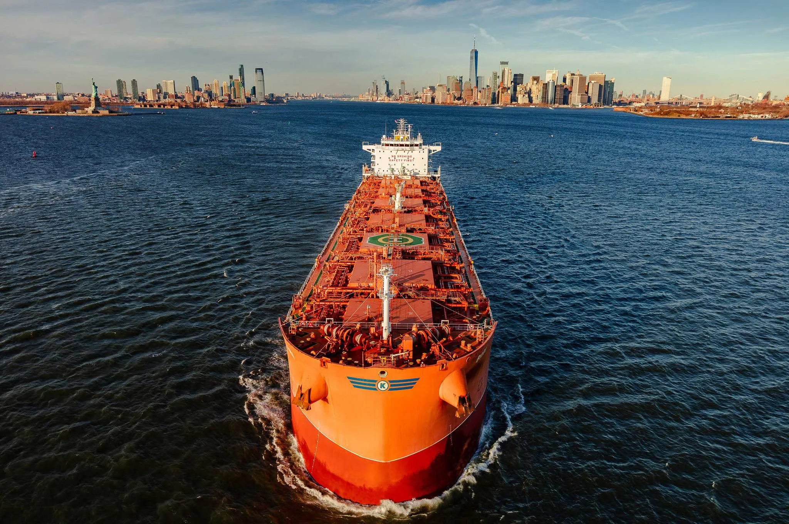

Oslo, 11 May 2022: Klaveness Combination Carriers ASA (“KCC”) secured a solid start to 2022 with first quarter adjusted EBITDA of USD 17.8 million. Customer growth and decarbonization milestones mark a quarter of significant progress for KCC, says CEO Engebret Dahm.

KCC reports satisfactory profitability in Q1 2022 despite a relatively weak start of the year for both the product tanker and dry bulk markets. Both markets improved considerably during the quarter and with both markets at historically strong levels, the outlook for KCC’s TCE earnings for Q2 is the highest for over ten years. This is further supported by high fuel prices due to KCC’s market leading energy and trading efficiency, adds Dahm.

The quarter also saw important milestones in KCC’s decarbonization program, with contracts secured for two major retrofit energy efficiency initiatives. The initiatives will deliver sizeable emission cuts and further cement KCC’s position as the world’s lowest carbon shipping provider in the dry bulk and tanker market.

Highlights for first quarter 2022:

- Average fleet TCE earnings $21,577/day, 1.8-2.8 times higher than standard tanker vessel earnings
- EBT USD 7.3 million and Adjusted EBITDA USD 17.8 million
- Three new CLEANBU clean petroleum product customers secured
- Concluded contracts for major energy efficiency retrofit installations on two vessels, with options for additional nine vessels
- Continued improvement in absolute CO2 emissions per vessel
- The Board of Directors declares dividends for Q1 of USD 0.180 per share, in total approximate USD 9.4 million

APM: Adjusted EBITDA and TCE earnings per on-hire day are alternative performance measures (APM) which are further described and reconciled in the quarterly report for Q1 2022, appendix 1 (page 23).

[View Q1 2022 Report](https://5479070.fs1.hubspotusercontent-na1.net/hubfs/5479070/KCC%20Reports%20and%20Presentations/KCC%202022%20Q1%20Report.pdf)

[View Q1 2022 Presentation](https://5479070.fs1.hubspotusercontent-na1.net/hubfs/5479070/KCC%20Reports%20and%20Presentations/KCC%202022%20Q1%20Presentation.pdf)

## Invitation to presentation of Q1 2022 financial results:

In connection with the release of financial results for the first quarter of 2022, Klaveness Combination Carriers ASA (“KCC”) will hold a webcast presentation at 09:00 CEST on Wednesday 11 May 2022*.*

To follow the webcast live go to [www.combinationcarriers.com/investor-relations](https://www.combinationcarriers.com/www.combinationcarriers.com/investor-relations) or [https://www.combinationcarriers.com/kcc-q1-2022-financial-results](https://www.combinationcarriers.com/kcc-q1-2022-financial-results). Questions for the Q&A session can be submitted in writing through the webcast solution during the presentation.

## About Klaveness Combination Carriers ASA:

KCC is the world leader in combination carriers, owning and operating eight CABU and eight CLEANBU combination carriers. KCC’s combination carriers are built for transportation of both wet and dry bulk cargoes, operating in trades where the vessels efficiently combine dry and wet cargoes with minimum ballast. Through their high utilization and efficiency, the vessels emit up to 40% less CO2 per transported ton compared to standard tanker and dry bulk vessels in current and targeted combination trading patterns.

## For further queries, please contact:

Engebret Dahm, CEO

Telephone [+47 957 46 851](tel:+4795746851)

Liv Dyrnes, CFO

Telefon [+47 976 60 561](tel:+4797660561)
