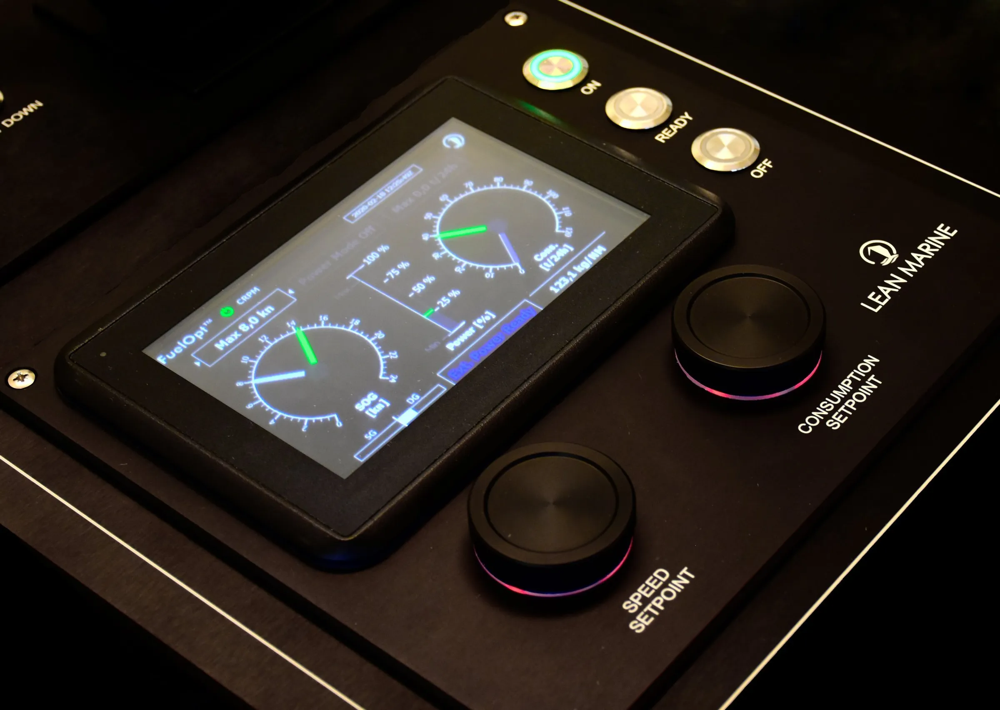

Klaveness Combination Carriers (KCC) has entered an agreement with Yara Marine Technologies to roll out their ‘FuelOpt’ solution aboard two pilot vessels - MV Bakkedal and MV Bantry.

The FuelOpt technology controls the vessel’s propulsion based on the commands set from the bridge and adapts the propulsive power to changing environmental conditions. Operating with steady and predictable shaft power, the system uses data from fuel flowmeter, shaft power meter, speedlog, weather signals, and other signals on board to enhance a vessel’s operational efficiency. The pilot vessels will receive the equipment and commission the system over Q2 2022.

Pending a successful outcome, KCC may decide to install the ‘FuelOpt’ solution on the full CABU fleet over the next 1-2 years.

The aim of the initiative is to further assist the vessel and crew with an automated tool enabling the control of key operational parameters: power, fuel consumption, and vessel speed.  Maintaining a constant, steady power over a voyage is found to give overall fuel savings. The initiative is a part of KCC’s ongoing efforts to improve fleet efficiency and deliver sizeable cuts in CO2 emissions from our operations.

## About Klaveness Combination Carriers ASA

KCC is the world leader in combination carriers, owning and operating eight CABU and eight CLEANBU vessels. KCC’s combination carriers are built for transportation of both wet and dry bulk cargoes, being operated in trades where the vessels efficiently combine dry and wet cargoes with minimum ballast. Through their high utilization and efficiency, the vessels emit up to 40% less CO2 per transported ton compared to standard tanker and dry bulk vessels in current and targeted combination trading patterns.

## About FuelOpt

FuelOpt is an add-on propulsion automation system providing direct control of power, fuel consumption, speed, or a combination thereof via an intuitive panel on the bridge. The system dynamically controls the vessel’s propulsion based on the commands set and adapts propulsive power to changing environmental conditions. It achieves steady and predictable shaft power and removes costly variations in speed and power resulting in real-time fuel savings and emissions reductions.

Source: [Yara Marine Technologies](https://yaramarine.com/lean-marine/fuelopt/)
