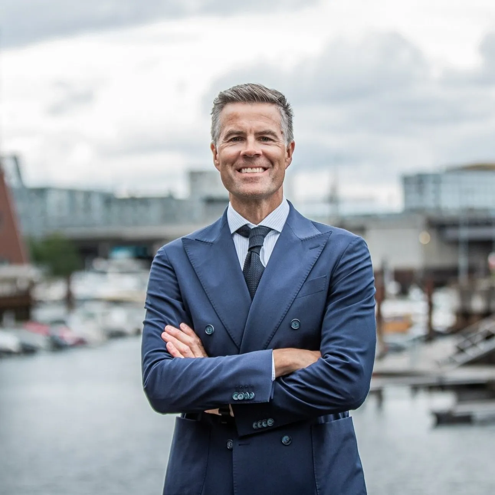

Klaveness Digital is pleased to announce that Sten-Roger Karlsen and Thomas Falck will be joining the Board of Directors from October 2022.

The Board now consists of the internal expertise of Torvald Klaveness together with external members that possess strong track records in B2B SaaS (Software-as-a-Service) enterprise growth.

### Sten-Roger Karlsen

Sten-Roger Karlsen has been the CEO of Ørn Software for the past four years of his 22 years working in software and technology. During Karlsen’s tenure, the company raised more than 250 NOKm from international investors for its IPO on the Euronet Growth Stock Exchange in March 2021 and has increased its Annual Recurring Revenue (ARR) by more than 1100%. In addition, Karlsen has also served as COO of the maritime tech company Star Information Systems AS, as well as holding the same position with Ecowat AS and Sales and Marketing Director with Sensorlink.

Karlsen comments: “I believe Klaveness Digital has a unique offering that makes a real impact on the shipping and logistics industry. Great technology and a skilled team, combined with Klaveness’ maritime heritage and industry knowledge is a formula I really believe in.

I hope that my experience from taking a SaaS company on a similar journey will add good value to the company. I am looking forward to being a part of the team and the exciting opportunities that lies ahead.”

### Thomas Falck

Thomas Falck is a professional Board Member and long-term backer of technology-based growth companies - as an angel investor, Board Member, or advisor. He has been the CEO of two international software and technology companies with Visma Marine ASA and Q-Free ASA, and he recently served as Head of SaaS Strategy & Execution and CFO of Cognite AS – a Norwegian ‘Unicorn’.

Falck has also been Chairman of Investinor AS, the Norwegian state-owned VC and Fund-of-Fund investor, as well as Managing Partner of Verdane Capital IV AS/Verdane Private Equity AS, as Executive Vice President in Visma Marine AS (SpecTec), a Principal Consultant in Gemini Consulting as well as having served as the Executive Officer of a Submarine.

Falck comments: “With CargoValue, Klaveness Digital has developed an important and very valuable software for understanding and optimizing global supply chains, improving resilience, saving costs, and reducing the waste of time, money and resources.

I look forward to joining the Klaveness Digital Board and to support management and the company in its journey. I am excited about the long-term prospects of CargoValue and will hopefully support with providing perspectives and ideas from other SaaS success stories, particularly on the go-to-market side.”

---

## About Klaveness Digital

Klaveness Digital is a Norwegian technology company on a mission to bring shipping and logistics into the future They develop intelligent solutions using the latest advances in machine learning and artificial intelligence, to solve the everyday problems that some of the world's largest industrial companies are facing.

The companies’ flagship product, CargoValue, is a Software as a Service (SaaS) solution that provides industrial companies with a digital twin of their seaborne supply chains. The platform improves supply chain management by delivering real-time visibility, improving transparency, and fostering collaboration between stakeholders involved in the planning, scheduling, and production processes.
