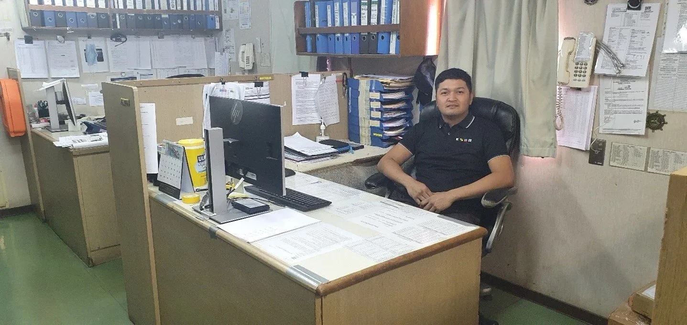

A seafarer's job is challenging to say the least. The work is hard and often highly physical, and many miss family and friends back home as they spend months at sea at a time. Luckily, the upside for many outweighs the downside, and Alex Jr Adolfo who is Chief Engineer on board Bangor and Billy Davis Bañocia who is on his way onboard as Captain on Baffin who are both sailing on board Klaveness CABU vessels, are no exception.

Alex joined Klaveness 18 years ago after completing his studies in marine Engineering at Lyceum International Maritime Academy and became the second group of students that graduated as part of MDP, as an Engine Boy. Whereas Billy was part of the first group of students graduating the year before. Both received training under the supervision of Captain Carlos Aguado and learnt the basic skills of a seafarer in that first year, such as crane driving, payloader driving and good seamanship before boarding their first vessel in the following year.

The purpose of the MDP was to recruit Maritime Bachelor Graduates from Maritime Schools in less fortunate areas, have them undergo a training program making them ready for deployment onboard as Engine – and Deck Boys. After 1 – 2 contracts as a Deck – or Engine Boy onboard Klaveness managed vessels, they would qualify for their Certificate of Proficiency (COP) as Wipers or Ordinary Seaman and continue a career as a rating. Over time, some graduates through the MDP showed talent enabling Klaveness to transfer them into the officers ranks and work their way through the officers ranks. Alex and Billy are amongst those talents.

**No day is the same at sea**

When asked about a typical day at sea Alex said, “As a Chief Engineer a typical day always starts with discussions with the First Assistant Engineer around the jobs, we will carry out that day, planned maintenance for the engine, updates, checking and ordering spare parts and things like that. I also do routine rounds on the engine and deck for monitoring equipment that need attention or maintenance, look at daily fuel consumption calculations and get up to date on my email correspondence.”

Busy to say the least! Billy shared, “I spend a lot of my time communicating with Owners, Charterers and Agents. Perform weekly monitoring and making sure daily work plans are properly and safely executed. Ensuring the safety of navigation crew, the vessel, cargo, and environment and so forth”.

**Challenging, but fun**

When the two of them speak about the highlights of their jobs at sea, Alex is keen to share that he enjoys the hands-on work with the machinery and doesn’t mind getting his hands dirty. As a Chief Engineer he still enjoys getting involved in repairs and giving an extra hand and additional supervision. Billy on the other hand said, “The thing I enjoy the most in my job is meeting different people from different cultures from all around the world. I also enjoy seeing the crew on board working as a team and sharing their ideas towards safety and positive outcome”.

Since they are away for months at a time, we were curious to learn about the qualities they thought were necessary to enjoy the job. Billy immediately jumped in and said, “To me, the most important personal qualities of being a seafarer are being respectful, disciplined, cooperative, open-minded and always willing to learn”, and Alex agreed. He said, “it helps that you are passionate about your chosen career and like to meet new people from different cultures”.

**Any advice to those considering a career at sea?**

Like any other career, working at sea has its ups and downs, but Alex and Billy both agree that the hardest part of their job is being away from family for long stretches of time. At the same time, they both think it’s very fulfilling to think about the opportunities they can give their children whilst doing a job they love.
Billy leaves us with this, “I think the most important thing to remember is that safety and respect are your assets onboard the ship”.
