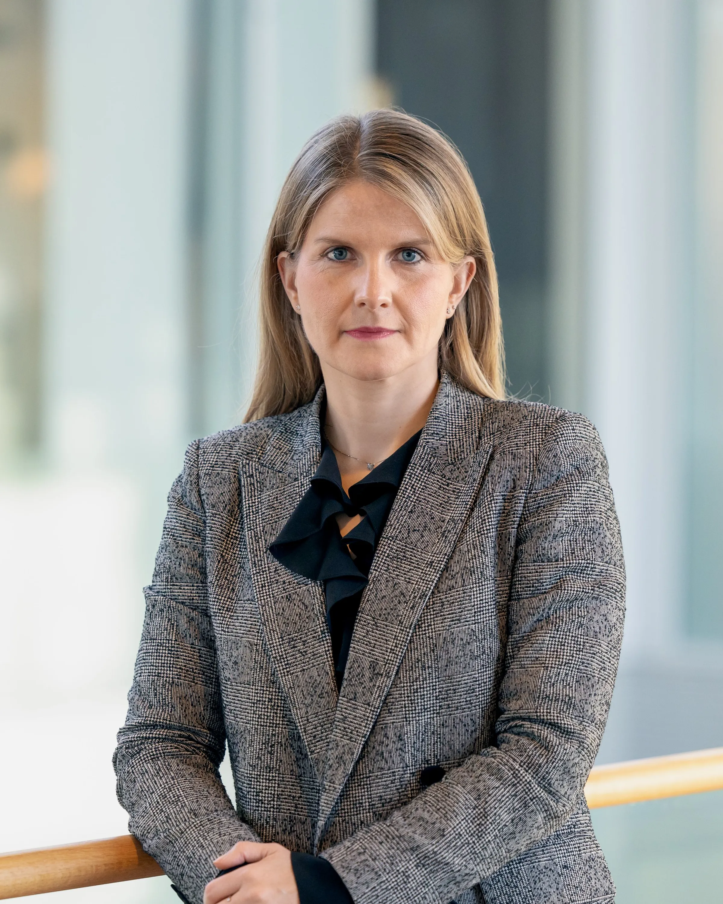

*A ZeroLab opinion piece first published in* [*Lloyd’s Register’s Horizons*](https://www.lr.org/en/insights/articles/shipping-decarbonisation-real-prisoners-dilemma/)

Decarbonization is posing a real prisoner’s dilemma\* for shipping: how can we overcome individual company incentives in favor of the common good? Economic theory teaches us that regulation is one way out of the prison: by altering present-day incentives, behavior can shift rapidly. Unfortunately, this is not happening fast enough. The Paris Agreement was signed in 2015, but six years on the IMO has yet to formalize a target that would align the shipping industry with carbon-neutrality by 2050.

When institutionalized regulation is lacking, another way out of the prison is to develop strategies that reward collaboration. In Klaveness, we are dedicating ourselves to creating products and business models allowing stakeholders in the shipping value chain to collaborate on emission reductions. Business models that incentivize collaboration should allow the participants to move ahead with decarbonization even as the regulatory framework is lacking, and they must efficiently reduce the risks of being a frontrunner. Two approaches are emerging for those that want to get started on commercially driven decarbonization today: high-quality carbon credits and a remake of the well-established bunker adjustment clause.

The voluntary carbon market can be a powerful tool for shipping decarbonization if it supports the right projects. Carbon credits from insetting can do exactly that: insetting refers to projects within the relevant value chain as opposed to offsetting, which refers to carbon reduction or removal projects anywhere and most often outside of the sector where the emissions originated. Today, in the absence of an industry-wide carbon levy, many decarbonization projects are prohibitively expensive. Carbon credits from insetting can help overcome the current funding gap and speed up the transition to low- and zero-emission technology.

> *\*A prisoner's dilemma is a situation where individual decision-makers always have an incentive to choose in a way that creates a less than optimal outcome for the individuals as a group.*
>
> *\*\*Scope 3 emissions are the upstream and downstream value chain emissions and include emissions from transport of supplies as well as transport of products. Shipping emissions are thus part of the Scope 3 emissions for aluminum producers.*

A high-quality carbon credit made available through a robust book and claim-mechanism decouples the emission reduction benefit from the actual project implementing the solution and makes it possible to match ambitious organizations that want to support the realization of low-emission technology.

Carbon credits from insetting spread the cost of emission reductions throughout the supply chain and allows the purchasing entity, for example a cargo owner, to legitimately claim supply chain emissions reductions in their Scope 3\*\* emission inventory even if their cargo was not carried on the ship that realised the emission benefits. The concept is of particular significance for environmental upgrades of the existing fleet and for fuel-switching. To ensure the environmental integrity of such projects, it is essential to apply stringent additionality criteria. Credits should only be generated from savings that fulfil the additionality criteria, i.e., go beyond mandatory requirements.

Another possibility is to include a carbon-emission adjustment factor (CEAF) in contracts. Very often, the decarbonization discussion in shipping focuses on the endgame: how will we design zero-emission vessels? When will alternative fuels become available? It ignores the significant emissions reductions that can be obtained through greater focus on operational improvements today. The CEAF-clause should incentivize the operator to meet a pre-agreed emission target (measured for example in kg CO2 emitted per tonne cargo transported), and equally result in reduced freight if the emissions are higher. The CEAF is an option immediately available to impatient operators and cargo owners that would like to make collaboration on decarbonization commercially tangible.

To accelerate the decarbonization of shipping, formal regulation is key. In the meantime, collaborative business models are a place to start.

## About ZeroLab

Established in 2021, ZeroLab is the youngest explorer amongst the Klaveness companies and is dedicated to the decarbonization of seaborne supply chains.

ZeroLab is currently developing several initiatives to make low-and zero emission options available. It partners with ambitious cargo owners who want to lead the way in creating a market for low-carbon deep sea shipping and identify and reduce carbon risk in seaborne supply chains.
