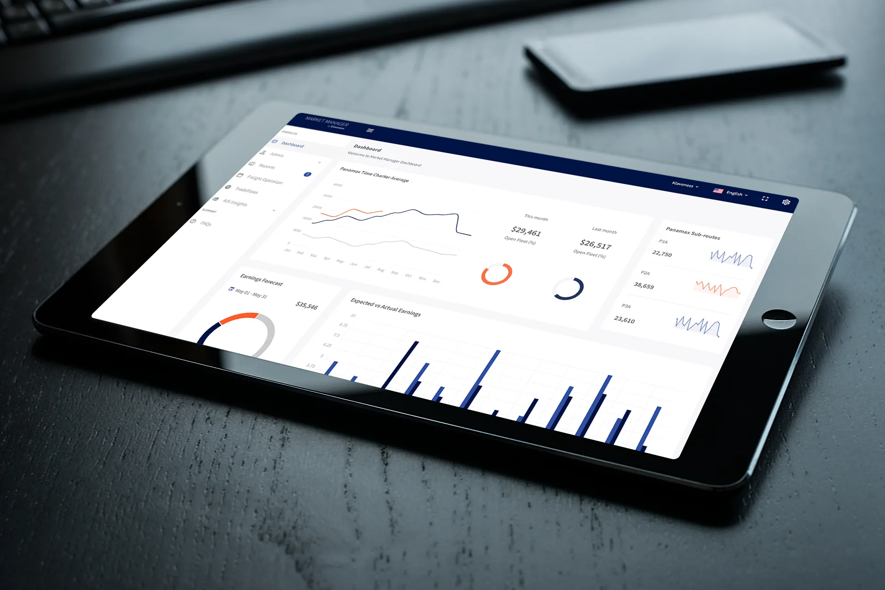

**Klaveness takes home the trophy for the ‘Shipping’ category**

*First published by* [*Singapore Business Review*](https://sbr.com.sg/) *24.05.2022*

Founded in 1946, Torvald Klaveness is a pioneering, data-driven, and safety-oriented shipping company. Its ship-owing arm is made up of a fleet of innovative combination carriers that can carry both dry bulk and clean petroleum products and emit up to 40% less CO2 per ton-mile compared to a standard tanker or bulk carriers in similar trading patterns

Since 2014, Klaveness has embarked on a digital journey, launching CargoValue through its subsidiary, Klaveness Digital, becoming one of the first shipping companies to provide digital solutions to new and existing customers.

Over the course of the past year, Klaveness launched its latest digital offering, Market Manager (MM), through its dry bulk business, with a strategic focus on developing value-driven solutions for the dry bulk industry. The agile MM team has great ambitions to democratise data solutions that empower shipowners and industrial participants alike to make better commercial decisions.

The MM team is made up of a handpicked group of select individuals with prior experience in developing maritime solutions. They provide key insights into the development of the solutions. Through working in sprints, the team swiftly assesses new ideas, builds Minimum Viable Products (MVP) and tests them with potential customers.

In its first year, MM has secured several customers in parallel to the development of its solutions. The unique solutions have helped these satisfied customers to make better-informed decisions and maximise the potential earnings on their vessels.

In the second year of its journey, the MM team remains full steam ahead on developing its digital arsenal that will offer dry bulk players innovative new ways of doing business.

Amongst Klaveness' key achievements were:

- Bespoke reporting by MM that helped customers maximise vessel earnings
- A ‘Pre-vetting’ solution that helps reduce voyage costs by about USD 60,000 per voyage when used to its potential
- The ‘Freight Optimizer’ solution, a tool that enables industrial clients to time their freight related decision making through a range of digitally enabled insights combined with the domain knowledge of Klaveness
- A vessel commercial assessment solution, ‘The Deck,’ which has helped customers assess more than 40 vessels before purchase

"The ability to capture, process, store, and analyse data efficiently and securely, will undoubtedly unlock significant productivity gains and business opportunities," Mr S Iswaran, Minister for Transport, said. "For instance, Klaveness established a new business unit, Market Manager, to develop vessel operating solutions as part of its digital freight and tonnage platform. Equipped with machine learning and data-driven decision-making tools, the platform helps its clients to manage their market portfolio and risk exposure," Iswaran added.

For these, Torvald Klaveness was recognised in the Shipping category at the SBR International Business Awards. The awards programme, presented by *Singapore Business Review*, gives recognition to the outstanding projects of foreign companies in Singapore.

Michael Jørgensen, Head of Dry Bulk at Klaveness, commented, “we remain convinced that an experienced freight trader with the insights of our products will be able to increase margins at low risk. When it comes to the range of daily activities within a Dry Bulk Shipping company such as research, counterparty assessment, and risk analysis, etc., its every company for themselves. We in MM strongly believe that 80% of the information leveraged is similar between companies and hence see these areas as good targets for mutually beneficial collaboration.”

## About Klaveness

Torvald Klaveness is a pioneering shipping company with the vision to improve the nature of shipping and the ambition to make seaborne supply chains resilient, decarbonised, and cost-effective. The group today consists of five business units; through Klaveness Combination Carriers, the company takes an active part in the transition to low-carbon shipping with the unique concept of combination carriers. Our Dry Bulk unit is a leading operator and service provider to the global dry bulk industry and manages the world’s largest Panamax Pool. Klaveness Ship Management manages the owned vessels from an environmental, technical, and commercial standpoint. Klaveness Digital has developed the world’s leading platform for managing seaborne supply chains. Our newest venture, ZeroLab by Klaveness, is developing several initiatives to make low-and zero-emission options available to our customers.

With over 75 years experience, Klaveness operates close to 100 vessels through offices in Oslo, Singapore, Manila, and Dubai with around 190 employees onshore and close to 850 seafarers.
