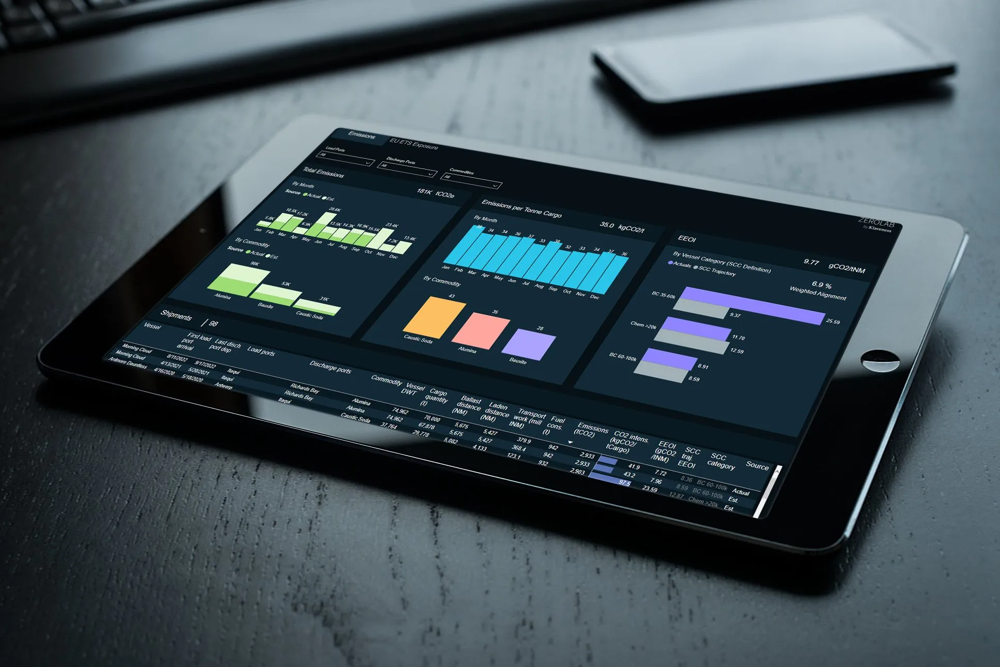

ZeroLab by Klaveness today announces that it has completed a milestone project with CBH Group, Australia's largest co-operative and a leader in the Australian grain industry, delivering its first detailed analysis of CBH’s GHG emissions from shipping in 2021. The deal expands ZeroLab’s foothold in the grains industry as they continuously strive to reduce CO2-emissions from global shipping across industrial sectors.

“We are delighted to conclude this initial evaluation with CBH in quantifying their emissions from shipping. CBH has a strong reputation when it comes to sustainability, and better understanding the carbon footprint of their supply chain will help them on their journey towards better sustainability outcomes,” says Morten Skedsmo, Head of ZeroLab.

The work focused on CBH’s ‘Scope 3’ emissions from shipping, also known as indirect supply chain emissions, and was powered by Klaveness Digital’s CargoValue platform - a solution that provides industrial companies with a digital twin of their seaborne supply chain.

“As our customers increasingly care about the carbon footprint of grain, it is important for us to understand the role of shipping in our supply chain emissions, and the data-driven insights provided by ZeroLab will support our overall sustainability goals” added Pia van Wyngaard, Head of Chartering at CBH Group.

## About ZeroLab by Klaveness

Established in 2021, ZeroLab is a subsidiary of Torvald Klaveness designed to identify and commercialize new business opportunities related to decarbonization of supply chains. ZeroLab identifies and commercializes business opportunities related to decarbonization of shipping. Any potential business models are in scope, but the company prioritizes solutions that are scalable and digital. ZeroLab develops solutions that create real and traceable impact on reducing greenhouse gas emissions within the shipping industry.

## About CBH Group

The CBH Group is Australia’s largest co-operative and a leader in the Australian grain industry, with operations extending along the value chain from fertiliser to grain storage, handling, transport, marketing and processing. Owned and controlled by more than 3,600 Western Australian grain growing businesses, CBH is Australia's largest exporter of grain.
