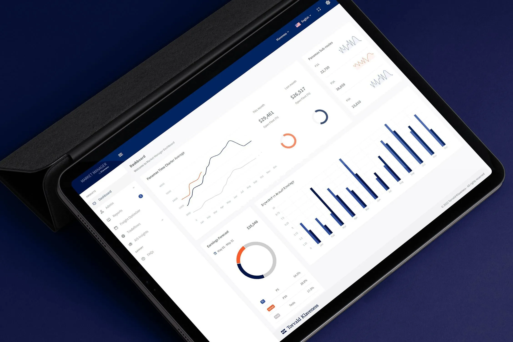

Oslo, 28 August 2023 - Torvald Klaveness and Lauritzen Bulkers, leading global dry bulk shipping companies, are pleased to announce a collaboration move that sees Lauritzen Bulkers testing Market Manager by Klaveness for better decision-making.

Niels Josefsen, CEO at Lauritzen comments: “Over the past four years, Lauritzen Bulkers has transformed from a traditional ship owner and operator to a company with increasing focus on active portfolio management. We strive to refine our knowledge-based business model and data driven approach.”

Michael Jørgensen, EVP and Head of Dry Bulk at Klaveness, adds: "We continue to challenge the status quo for better outcomes and if we can assist like-minded operators in achieving the same efficiencies, it is only natural we share it. Collaborating with Lauritzen and learning from their feedback will be a welcome inclusion to our development process.”

## About Lauritzen

An agile operator in a dynamic market. As part of the Lauritzen Group, Lauritzen Bulkers is proud of our rich history within the shipping industry and the experience and craftsmanship delivered by our employees throughout the past century. We continue to showcase our capacity to adapt and transform into a modern shipping company - while remaining true to our company's heritage and core values. Lauritzen Bulkers is proud to be owned by Lauritzen Fonden, a commercial foundation contributing to various non-profit initiatives and focused on making a lasting impact within communities around the world.

## About Klaveness

Torvald Klaveness is a pioneering shipping company with a vision to improve the nature of shipping and ambition to make seaborne supply chains resilient, decarbonized, and cost-effective. The Group consist of a holding structure and four operating companies; through Klaveness Combination Carriers, the company takes an active part in the transition to low-carbon shipping with its unique combination carrier concept. Dry Bulk by Klaveness is a leading operator servicing the global dry bulk industry, they manage the world’s largest Panamax Pool and Market Manager, a digital platform enabling clients to make data-driven freight decisions. Klaveness Ship Management manages the owned vessels from an environmental, technical, and commercial standpoint. Klaveness Digital has developed the world’s leading platform for managing seaborne supply chains with CargoValue. The Holding team incorporates ZeroLab by Klaveness, our strategic arm incubating new products and business models to accelerate decarbonization of global shipping.

With over 75 years’ experience, Klaveness operates some 100 vessels through offices in Oslo, Singapore, Manila, and Dubai with around 200 employees onshore and close to 850 seafarers.

More information about our company and our activities can be found at [www.klaveness.com](/).

## About Market Manager

A Software-as-a-Service (SaaS) platform crafted by Klaveness Chartering, incorporating extensive commercial expertise, and backed by our best-in-class research team. The platform enables customers to drive new value and make better informed decisions to navigate shipping markets.
