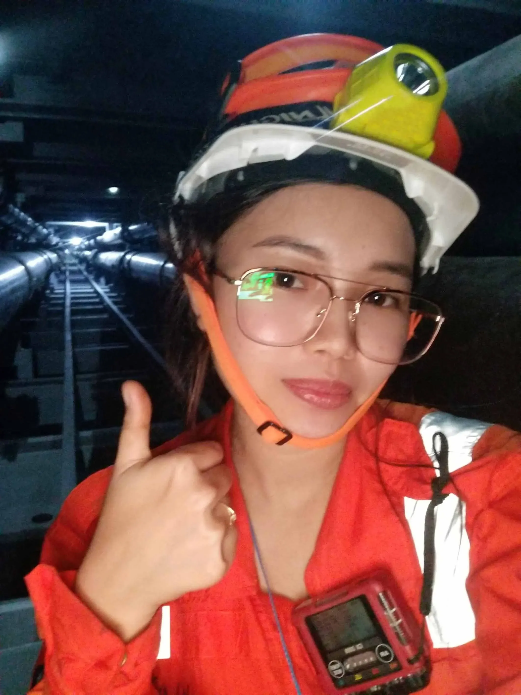
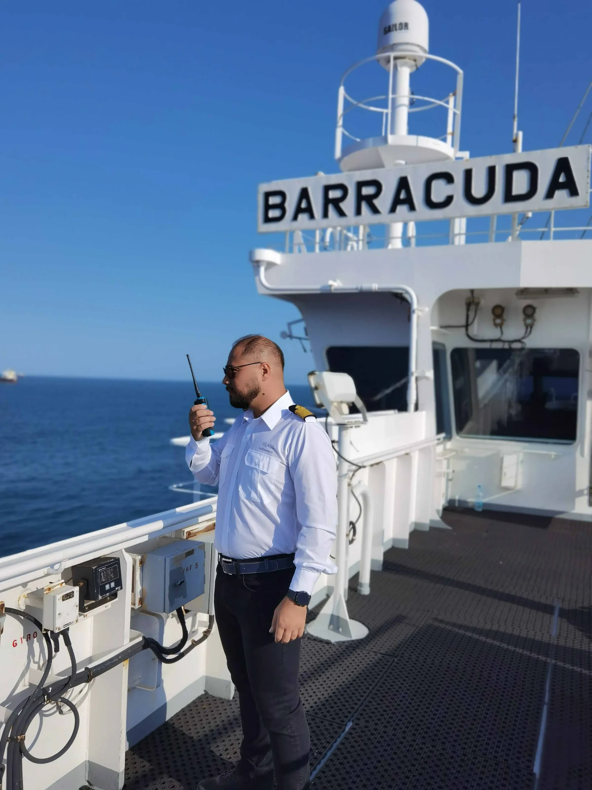
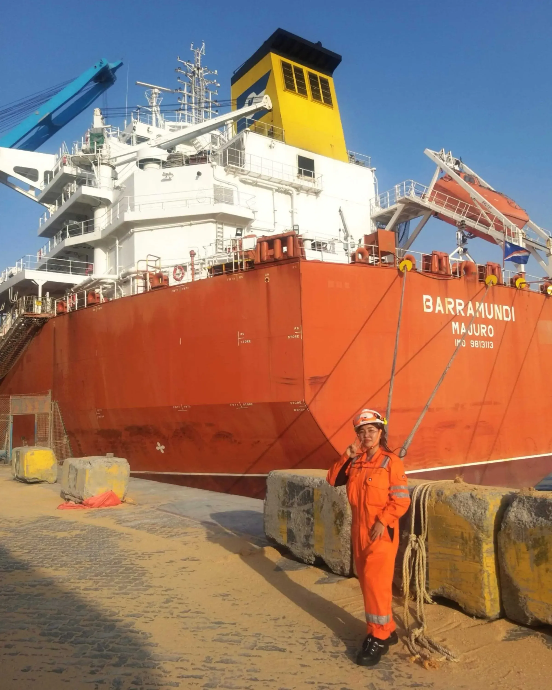

**International Day of the Seafarer 2023 | Ocean’s Worth Protecting**

Over the past decade, digitalization has risen to a mega-trend in shipping. The calls for more environmentally sustainable shipping practices are growing louder, with decarbonization-driven trials and technologies resonating through the seaborne supply chains of many major charterers and operators worldwide. Serving as the backbone of global shipping, but standing at the forefront of this rapidly changing landscape, are the world’s seafarers.

In light of International Day of the Seafarer 2023, we took the opportunity to speak with two of our seafarers, serving as veteran and recent recruit, on how the maritime revolution has evolved the modern seafarer.

Captain Robert-Dragos Valcica, a Klaveness veteran of 13 years, serves as Master aboard MV Barracuda. Cadet Mary Jane Enhambre Siy Chuan, an Electrical Engineer aboard MV Barracuda, has sailed with Klaveness for almost 1 year. Both share their thoughts on what they believe are essential skills and knowledge required in this new era, how they envision the seafarer of tomorrow, and share with us a personal experience that spotlights the significance being a seafarer in our rapidly changing world.

## Navigating the digital seas

The advent of digitalization has equipped shipping with more capabilities when it comes to operational efficiency, some examples being navigation, weather routing systems, remote monitoring technology, and digitizing of records for more efficient storage and transfer of information. In addition, energy efficiency initiatives essential for spurring forward decarbonization of global shipping, increase the count. Klaveness Combination Carriers (KCC) currently has a number of such initiatives underway or under consideration in the fleet, each one requiring new competence and commitment.

Asked how the integration of these technologies has changed the role of seafarers, both remark how the advancements have triggered several transformations in the daily tasks and responsibilities of seafarers aboard. Capt. Valcica comments, "we have to be proficient in the use of various software, hardware, and communication systems, in addition to traditional navigation and maintenance tasks. We must also be familiar with the latest regulations and environmental standards and implement them onboard.” Cadet Siy Chuan concurs, citing that growing environmental concerns means seafarers, “must continually upgrade our skills to keep pace with the evolving demands of the shipping industry.”

Both are strong believers in the value that they believe the change has brought them and to shipping in general. Capt. Valcica adds, “the ability to identity and resolve potential problems in real-time has reduced the risk of accidents and improved safety standards,” with Cadet Siy Chuan appreciating, “seafarers can embrace a more tech-savvy, environmentally conscious, and innovative approach to their responsibilities.”

## Skills of the modern mariner

KCC’s fleet of combination carriers, being able to carry both dry and wet cargo, already require a unique skill set from our seafarers. With the introduction of new technologies aimed at improving both operational and energy efficiency, it is easy to see why the seafarer of today needs to be a versatile and adaptable professional ready to equip themselves with an expansive skill set. Capt. Valcica, a seasoned seafarer with Klaveness acknowledges this and comments that from his tenure, he believes skills of paramount importance today are digital literacy, environmental awareness, safety management, multicultural communication, and a commitment to continuous learning.

Cadet Siy Chuan, still a relatively fresh recruit, remarks, “I have already undergone a continuous journey of skill development, having recognized the importance of technological proficiency in our rapidly advancing industry”. She outlines some examples of her self-initiated actions onboard to stay sharp, such as mastering the operating and troubleshooting of digital systems and equipment onboard.

Both highlight seafarers need to be aware of energy-efficient practices and environmentally sustainable measures in the shipping industry, commenting that for every new technology making its way onboard, the seafarer must be ready. While the prospect may appear challenging, both are encouraged to see it as an opportunity. They believe these skills will empower seafarers to, “better navigate the complexities of modern shipping, implement sustainable practices, foster effective teamwork, and adapt to ever-evolving regulations and industry trends.”

## The seafarer of tomorrow

As technology advances with increasing pace (with Artificial Intelligence (A.I.) now beginning to push boundaries) and as shipping continues its journey towards net-zero, the role of the seafarer is destined to undergo waves of transformation.

Capt. Valcica envisions a future where seafarers embrace cutting-edge green technologies, optimize vessel operations for energy efficiency, and may be able spend more time working onshore as they collaborate with remote teams through digital communication channels. He suggests, “smart automation and digitalization will enable more streamlined operations,” but points out that the seafarer of tomorrow will face new challenges, including cybersecurity risks and technical complexities. Capt. Valcica also adds that the implementation of the fuel of the future may require more extensive knowledge from seafarers and greater collaboration between stakeholders in the industry to ensure its success.

Cadet Siy Chuang supports this, acknowledging that to get there, “seafarers will need to enhance their digital and technological proficiency, focus on energy management, ensure environmental compliance, and adapt to evolving safety and emergency response measures.”

Asked what opportunities they see for the seafarer of tomorrow, both believe we will see more opportunities for career growth and seafarers becoming more tech-savvy and sustainability-driven individuals. Capt. Valcica adds, “they will have the opportunity to take part in reducing the industry's greenhouse gas emissions and play a key role in helping to shape the future of shipping.”

## Capturing the essence

In light of International Day of the Seafarer and its theme ‘Oceans Worth Protecting’, we asked both to share a personal story from that they believe encapsulates the significance of being a seafarer in today’s world.

Cadet Siy Chuang refers to a power surge as the vessel sailed through rough seas, with the clock ticking to restore normal power and maintain the vessel's stability. She comments, “this fueled my motivation to continue my career in the maritime industry. It showed me the real-world impact of my work, ensuring the safety and operational integrity of the ship. The dynamic nature of the job, the opportunity to work with advanced technologies, and the camaraderie among the crew members inspired me to further develop my skills and contribute to a more sustainable and efficient shipping industry.”

Capt. Valcica takes the opportunity to commend seafarers globally for their continued commitment and cites the COVID-19 pandemic as an example that has highlighted the vital role seafarers play and the challenges they face.

He concludes, “some find fulfillment in serving a humanitarian need and supporting global trade, while others view their profession as an adventure and opportunity to explore distant lands and cultures. Whatever their motivations, seafarers remain an essential and integral part of the shipping industry, and their contributions are invaluable to society.”

## Conclusion

In this ever-evolving maritime landscape, seafarers hold a vital role. While a sailor in the past typically focused on operations onboard related to a safe voyage, cargo handling and maintenance of the vessel, the future sailor will now also stand at the forefront of shipping’s decarbonization journey and be an operator of technological equipment driven to meet the future demands of owners, operators, regulators, and the general public. Through their embracement of new technologies, acquisition of essential skills, and unwavering dedication, seafarers will be instrumental in guiding the industry toward safer and greener horizons.

To get there, building confident and self-secure crew with in-depth knowledge will be key. The activities of KCC and Klaveness Ship Management (KSM) are of such nature, that there is no off-the-shelf-crew that can meet those requirements. As with Capt. Valcica and Cadet Siy Chuan, we take pride in building them up through our Cadetship – (Officers) and Manpower Development Program (Ratings) initiatives and join the maritime industry in extending our sincere gratitude to both, as well as well seafarers globally, on this International Day of the Seafarer 2023 and its theme ‘Oceans Worth Protecting’.

## About the interviewees:

**Name
**Captain Robert-Dragos Valcica

**Serving
**MV Barracuda

**Designation
**Master

**Seniority
**13 years

**Name**
Mary Jane Enhambre Siy Chuan

**Serving**
MV Baiacu

**Designation**
Electrical Engineer Cadet

**Seniority**
11 months
