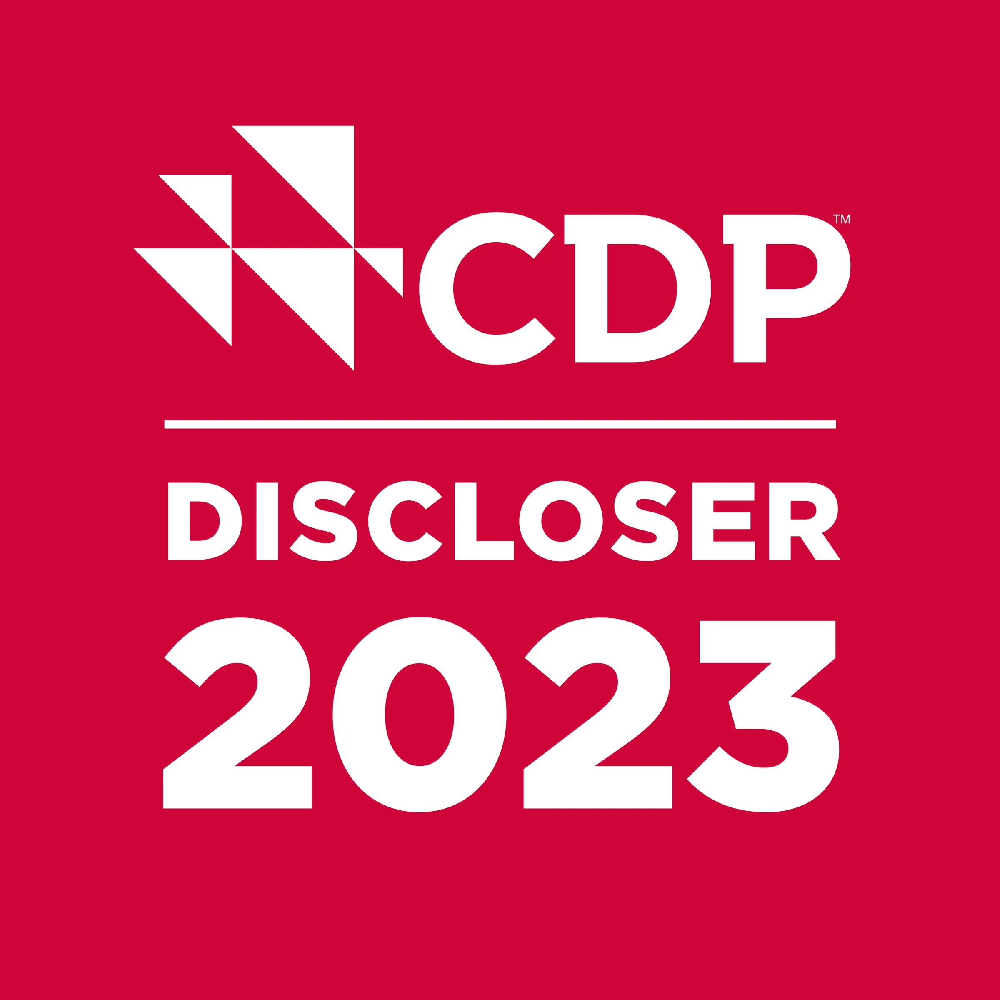

Oslo, 6 February 2024: Klaveness Combination Carriers ASA (“KCC”) has received its first A- score for “climate change” in the annual CDP disclosure, improving on its B score of the previous two years. The result positions KCC into the ‘leadership’ band of CDP’s scoring mechanism, described as ‘implementing current best practices’ and beating the marine transport industry average of B-.

The CDP (Carbon Disclosure Project) is a global non-profit that runs the world’s leading environmental disclosure platform. Grades are determined based on a transparent methodology that assesses the comprehensiveness of disclosures.

Liv H. Dyrnes, CFO and Deputy CEO of KCC comments: “We are pleased to see our commitments to improve our climate change performance are recognized with this year’s A- from CDP.  We have set meaningful, ambitious targets and are committed at all levels of the organization to see them through, while remaining transparent in our activities along the way. The result is a testament to KCC’s everyday efforts to deliver the most cost-effective decarbonization solution in deep-sea tanker and dry bulk shipping to our customers.”

[Read KCC 2023 CDP disclosure](https://www.cdp.net/en/responses/860918?back_to=https%3A%2F%2Fwww.cdp.net%2Fen%2Fresponses%3Futf8%3D%25E2%259C%2593%26queries%255Bname%255D%3DKlaveness%2BCombination%2BCarriers&queries%5Bname%5D=Klaveness%20Combination%20Carriers)

About Klaveness Combination Carriers ASA

KCC is the world leader in combination carriers, owning and operating eight CABU and eight CLEANBU combination carriers with three CABU vessels under construction for delivery in 2026. KCC’s combination carriers are built for transportation of both wet and dry bulk cargoes, being operated in trades where the vessels efficiently combine dry and wet cargoes with minimum ballast. Through their high utilization and efficiency, the vessels emit up to 40% less CO2 per transported ton compared to standard tanker and dry bulk vessels in current and targeted combination trading patterns.

About CDP

CDP is a global non-profit that runs the world’s environmental disclosure system for companies, cities, states and regions. Founded in 2000 and working with more than 740 financial institutions with over $137 trillion in assets, CDP pioneered using capital markets and corporate procurement to motivate companies to disclose their environmental impacts, and to reduce greenhouse gas emissions, safeguard water resources and protect forests. Over 25,000 organizations around the world disclosed data through CDP in 2023, with more than 23,000 companies – including listed companies worth two thirds global market capitalization - and over 1,100 cities, states and regions. Fully TCFD aligned, CDP holds the largest environmental database in the world, and CDP scores are widely used to drive investment and procurement decisions towards a zero carbon, sustainable and resilient economy. CDP is a founding member of the Science Based Targets initiative, We Mean Business Coalition, The Investor Agenda and the Net Zero Asset Managers initiative.

For further queries, please contact:

Liv Dyrnes, CFO and Deputy CEO

Telephone: [+47 976 60 561](tel:+4797660561)
