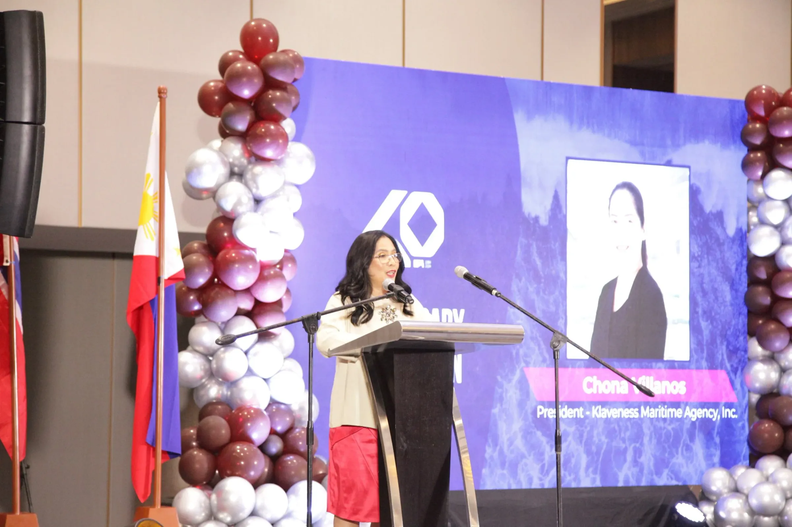

**Manila, Philippines - 06/11/24 -** Klaveness Maritime Agency, Inc. (KMAI) marked its momentous 40th anniversary with an unforgettable celebration on November 6, 2024, at the Lanson Hotel in Manila. This event not only paid tribute to KMAI’s rich history of achievements but also embraced the promise of new beginnings as it transitions to become a part of [OSM Thome](https://osmthome.com/), a global leader in ship management.

Attended by 150 distinguished guests, including employees, business partners, members of the Seaman’s Wives Association of Klaveness (SWAK), 39 maritime officers, and executives from OSM Thome, the gathering showcased the impact, culture and strong sense of community that defines KMAI.

**KMAI Celebrates Achievements**

The evening began with an invocation and the national anthems, setting the stage for a warm welcome from KMAI President Chona Villanos, followed by a speech by Trond Harald Klaveness capturing KMAI’s inspiring journey over the decades.

In recognition of dedication and service, maritime officers and SWAK volunteers received honors for their invaluable contributions, underscoring the event's celebratory spirit. The night continued with performances from Lyceum students and the presentation of a scholarship donation certificate, reflecting KMAI’s commitment to community support.

To conclude the memorable evening, CEO of Torvald Klaveness, Ernst Meyer led a toast, signaling the start of an exciting new chapter for KMAI.
