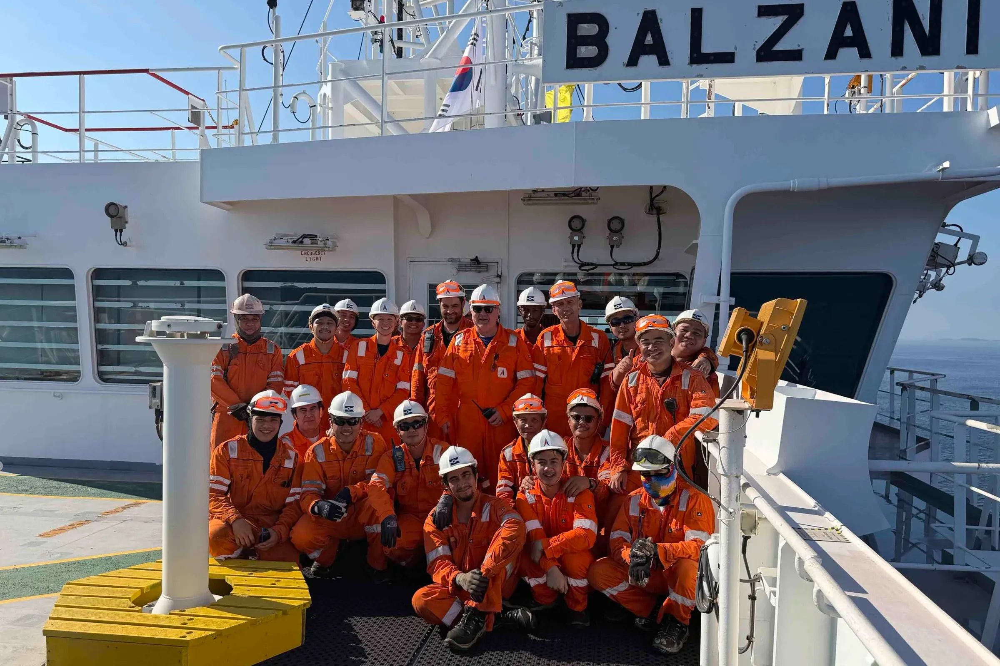
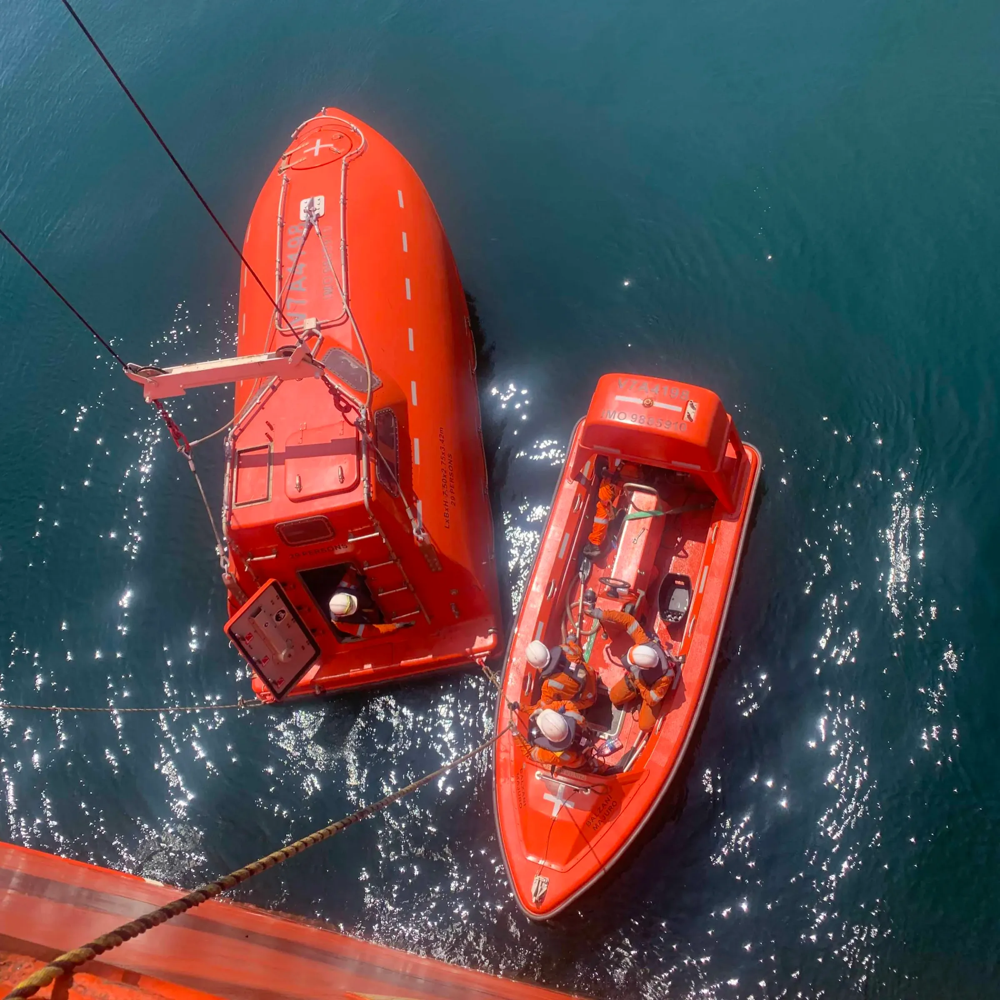
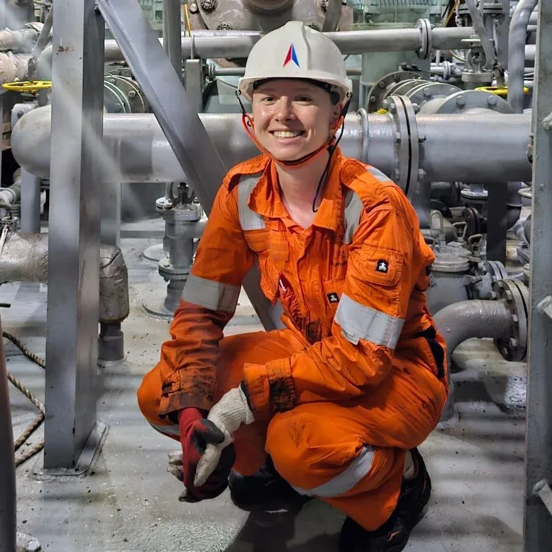

This summer, NTNU (Norwegian University of Science and Technology) student Cornelia Benjaminsen spent nine weeks onboard the KCC CLEANBUvessel MV Balzani, sailing between ports in Taiwan, South Korea, Australia and Tasmania.

The experience gave her a firsthand look at life at sea and with it a new perspective on the shipping industry.

## Seeing shipping up close

For Cornelia, one of the biggest lessons was understanding how everything onboard connects. "Being onboard, you see how everything combines and works together as one ship. That's hard to understand from studies alone."

Among the tasks she took part in were cleaning a fuel oil purifier and other planned work and operations in the engine room, which she mentions give her a firsthand look at how things work. In addition, Cornelia says the experience also reinforced the importance of keeping the end user in mind when designing solutions and making decisions onboard.

"It's important to have the user in mind when it comes to implementing complex new technology, but also how things as small as what type of broom to order can make a massive difference to those actually using the equipment onboard."

She was also surprised by the variety of working environments vessels encounter around the world. "It's easy to think everything is automated these days, but then you hear stories about ports where materials are still handled very manually. It was fascinating to see how the vessel needs to be able to adapt to different ports to make a combination trade work.."

## Taking ownership of her own learning

Cornelia reflects that getting the most out of a seagoing internship requires curiosity and initiative. "You really have to put yourself out there, take initiative, ask questions and show that you're interested. You want to do more than just watch or listen."

One of her favorite experiences was  joining the crew in troubleshooting a long-running issue with an auxiliary engine. Following the process from start to finish gave her a unique insight into the craftsmanship, attention to detail and problem-solving skills experienced seafarers bring to solve complex technical challenges.

Cornelia also mentions that what stood out just as much was the professionalism of the crew and Balzani’s strong safety culture. Before joining the vessel, Cornelia admits she did not know quite what to expect from life at sea but after nine weeks onboard, she left with a very different impression. She says the crew's commitment to doing things the right way was evident throughout her stay.

“Regular safety drills, clear procedures and a crew committed to doing things the right way helped create an environment where I felt safe, supported and included in my time there.”

Looking back, Cornelia says she would fully recommend the experience to other students. "It's an experience you can't get anywhere else. Going back to my studies now, I have a much deeper understanding of the industry. After seeing how hard the crew worked onboard, it motivates me to work even harder myself!”

---

