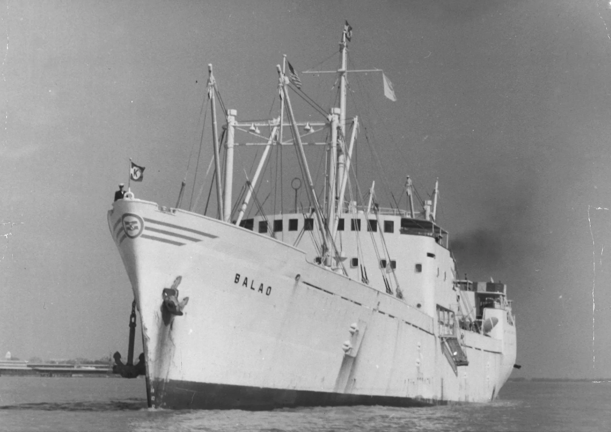

**Part 1 of an 8-part journey through the decades to mark our 80th anniversary**

In 2026, Torvald Klaveness marks 80 years in shipping. Over eight decades, the company has grown from a small post-war enterprise into an international group spanning physical shipping, freight trading and digital services. Much has evolved, yet the foundations of who we are today were laid in that very first decade.

**To understand how we arrived here, we return to 1946**

When a young Torvald Faye Klaveness established Rederi A/S Torvald Klaveness in 1946, he began with experience before tonnage. The original idea was straightforward: to provide technical management and Norwegian seafarers to American shipowners. From there, the business expanded into shipbroking, particularly in refrigerated trades laying the groundwork for something more.

**Experience before expansion**

The wartime years in Nortraship had given him operational insight and strong transatlantic relationships and those connections became the foundation of a new company. The post-war environment was demanding. Currency restrictions, capital constraints and administrative controls made it difficult for Norwegian shipowners to expand freely.

Through cooperation with Henry D. Mercer and States Marine Corporation in New York, Klaveness secured management responsibility for Norwegian-flag vessels tied to American commercial control from 1947. This gave the young company operational responsibility and international reach at a time when flexibility at home was limited, reflecting a deliberate approach rather than a pursuit of immediate scale.

**From management to ownership**

Vessel ownership came gradually. In the early years, the company built its position through a combination of ship management, brokerage and ownership stakes structured through dedicated shipowning companies and partnerships. Purchased tonnage, including Liberty-type vessels, formed part of this development.

Using proceeds from reefer broking, Klaveness contracted M/S Balao in 1950. Delivered in 1952 from Drammens Slip & Verksted, the 90,000 cubic foot refrigerated vessel was designed for fruit trades between South America and the United States. Balao marked a decisive step from managing ships to building and owning them.

At the same time, the company participated in a larger ore-carrier program linked to American steel interests. Through dedicated shipowning companies, a series of ore vessels was delivered in the first half of the 1950s. These projects combined Norwegian maritime competence with structured industrial cargo demand, reinforcing a pattern that would become characteristic of Klaveness: build around defined trades, partner closely with the industry, and structure ownership carefully.

This first decade of the Torvald Klaveness company was not defined by rapid expansion. It was defined by method. Experience became responsibility. Responsibility became ownership. And ownership meant steel on the water. Those early choices set a direction that would guide the company through changing markets, new partnerships, and future cycles.

In the next decade that method would evolve further as collaboration and pooling models began to reshape the way Klaveness operated in a changing shipping landscape.

**Next |** [**Torvald Klaveness 1956–1966: Pools and Partnerships**](/news/torvald-klaveness-19561966-changing-the-way-cargo-moves)

